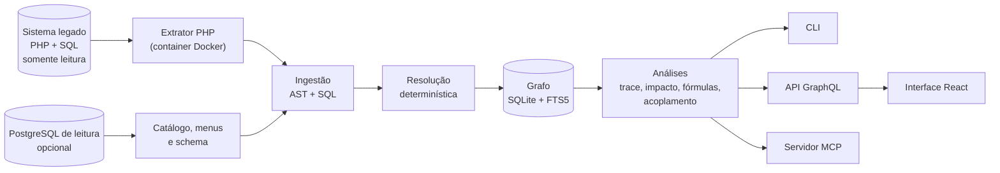

# php-map

[](https://github.com/cristianoDencode/php-map/actions/workflows/ci.yml)
[](LICENSE)
[](pyproject.toml)

Mapeia monólitos PHP legados num **grafo de conhecimento**, sem executar o código, para planejar a modernização aos poucos.

> **Feito para o e-Cidade.** O php-map nasceu para mapear o e-Cidade (ERP municipal em PHP procedural, com regras no PostgreSQL) e conhece as convenções dele: dicionário de dados, menus, DAOs, módulos e funções da base. Por isso o código e a documentação usam nomes do e-Cidade. Há também um perfil para projetos **Zend Framework 1**, e perfis novos podem ser acrescentados ([docs/perfis.md](docs/perfis.md)). Para outro sistema, o resultado é melhor quanto mais ele se parecer com esses.

> *English summary at the [end of this page](#english-summary).*

## O que é e por que existe

Um monólito PHP com dezenas de milhares de arquivos, SQL espalhado em strings e regras de negócio dentro do banco não cabe na cabeça de ninguém, nem na janela de contexto de um modelo de linguagem. O php-map lê o código e o banco **uma vez**, de forma determinística (AST do PHP, SQL e PL/pgSQL, catálogo de dados), e monta um grafo de telas, arquivos, classes, funções, tabelas, menus e módulos, com a evidência `arquivo:linha` de cada ligação.

Com o grafo você responde, sem abrir 45 mil arquivos:

- **de onde vem e para onde vai** um fluxo, de um item de menu até as tabelas que ele lê e grava;
- **o que quebra** se uma tabela ou função da base mudar;
- **onde está** uma regra de negócio e como um valor é calculado;
- **como os módulos se acoplam**, para escolher o que extrair primeiro (padrão *strangler fig*: estrangular o monólito por partes).

O sistema mapeado é **somente leitura**: o php-map nunca altera o código nem o banco dele.

## Funcionalidades

- **Scan:** extrator de AST do PHP (container Docker), leitura de SQL e PL/pgSQL (`pglast`), catálogo de dados e menus do e-Cidade e resolução de includes, classes, chamadas, rotas Laravel e RPCs.
- **Rastreio tela → banco** (`trace`) e **análise de impacto** (`impact`) de uma tabela, com diagrama.
- **Regras de negócio:** a ficha de uma tela (menus, ações, tabelas, validações e mensagens) e das funções da base, em português e sem IA.
- **Fórmulas e origem de valores:** cada cálculo de uma função da base, de onde vem cada entrada e em que menu ela é cadastrada (`value-origin`, busca por assunto).
- **Comunicação entre sistemas:** endpoints SOAP, RPC e rotas HTTP, com parâmetros, quem implementa e quem chama, e o cruzamento entre projetos (`cross`).
- **Módulos e acoplamento:** matriz entre módulos, tabelas compartilhadas e candidatos à extração (`boundary`).
- **Camadas:** do menu à tabela, passando por tela, JS, rota, controller, service, repository, model e DAO (`layers`).
- **Interface web** (React, API GraphQL somente leitura) e **servidor MCP** para assistentes de IA consultarem o grafo.
- **Login e papéis:** interface protegida por login, com papéis `admin` e `leitor`, e tokens com validade e revogação para o MCP.

## Arquitetura



Princípios:

1. **Determinístico primeiro.** Tudo o que a AST, o SQL e o catálogo respondem é resolvido sem heurística. O que é ambíguo é marcado e listado como pendência, nunca chutado em silêncio.
2. **Toda aresta tem `source` e `confidence`.** Você sempre sabe de onde veio a ligação (AST, SQL, catálogo, regra de nome) e quanto confiar nela. Veja a [ontologia](docs/ontologia.md).
3. **O grafo é um arquivo.** Um SQLite que você copia, versiona fora do repositório ou serve por MCP. Nenhum serviço para manter.
4. **Somente leitura** sobre o sistema mapeado.

| Pacote (`src/php_map/`) | Papel |
|---|---|
| `ingest/` | Descoberta de arquivos, extrator PHP, cache de AST, schema e catálogo do banco, XML de webservices |
| `resolve/` | Includes, símbolos, chamadas, SQL em strings, rotas Laravel, Zend 1, Doctrine/Eloquent, endpoints |
| `profiles/` | Perfis de sistema (`ecidade`, `zend1`) |
| `graph/` | Modelo, construtor e persistência SQLite do grafo |
| `search/` | Índice de busca textual (FTS5) |
| `analysis/` | Trace, impacto, fronteira, fórmulas, origem de valores, camadas, cruzamento entre projetos |
| `briefing/`, `report/` | Fichas, briefings e relatórios em Markdown/Mermaid |
| `web/` | API GraphQL (FastAPI + Strawberry), login e servidor da interface |
| `mcp/` | Servidor MCP somente leitura |
| `access/` | Cofre de acesso: usuários, papéis, sessões e tokens |

O detalhe está em [docs/arquitetura.md](docs/arquitetura.md).

Medido em 2026-11-06 sobre uma instalação do e-Cidade (35.359 arquivos PHP): **167.278 nós e 899.119 arestas** em um arquivo SQLite, scan em cerca de 5 minutos com o cache de extração. A precisão contra o gabarito está em [docs/precisao.md](docs/precisao.md).

## Requisitos

| Item | Detalhe |
|---|---|
| Python | 3.11 ou mais novo (o CI testa 3.12 e 3.14). No Ubuntu/Debian, o pacote `python3-venv` |
| Docker | Só para o extrator PHP: roda num container descartável com PHP 7.4. Com o cache de extração completo, o scan roda sem ele |
| Node.js | 20 ou mais novo, só para compilar a interface web |
| PostgreSQL de leitura | Opcional. Dá o catálogo (módulos e menus), o schema e o texto das funções da base. Sem ele, essas partes do grafo ficam de fora |
| Pasta do sistema | A instalação (ou uma cópia) do sistema a mapear. Para o e-Cidade, a pasta precisa ter `libs/db_stdlib.php` |

Linux e Windows são testados a cada alteração (CI).

## Instalação

**Linux (bash):**

```bash
python3 -m venv .venv
.venv/bin/pip install -e ".[mcp]"
.venv/bin/php-map setup-extractor --build-image   # constrói a imagem php-map-php74 (PHP 7.4 + composer)

cd ui && npm ci && npm run build && cd ..          # interface web (gera ui/dist)
```

**Windows (PowerShell):**

```powershell
python -m venv .venv
.venv\Scripts\pip install -e .[mcp]
.venv\Scripts\php-map setup-extractor --build-image

cd ui
npm ci
npm run build
cd ..
```

Sem o último passo, a API continua funcionando e a página inicial explica como compilar a interface. Desenvolvedores instalam também o extra `dev` (`".[dev,mcp]"`).

O extrator procura a imagem Docker nesta ordem: `--php-image`, a variável `PHP_MAP_PHP_IMAGE` (ambiente ou `.env`), `ecidade-windows-php74` (se existir) e `php-map-php74`.

## Primeiros passos

**1. Scan.** A interface precisa de um grafo para abrir, então o primeiro scan é pela linha de comando:

```bash
.venv/bin/php-map scan --source /caminho/do/sistema --reuse-ast --out out/meu-scan
```

A primeira extração leva de 6 a 15 minutos num sistema do porte do e-Cidade. Com `--reuse-ast`, os scans seguintes só reextraem o que mudou. O grafo fica em `out/meu-scan/graph.db`.

Para ler o catálogo e o schema do banco (recomendado no e-Cidade), crie um `.env` na raiz (ele está no `.gitignore`; nunca o versione):

```ini
PHP_MAP_CATALOG_DSN=host=<servidor> port=5432 dbname=<base> user=<usuario> password=<senha>
```

Sem banco, passe `--no-catalog-db` e, se tiver os scripts de DDL, `--schema <pasta ou arquivo .sql>`. O php-map só lê o dicionário de dados, os menus, o schema e o texto das funções, numa transação somente leitura; nenhum dado de negócio é lido nem gravado.

Para testar a instalação em segundos, use o projeto de exemplo que acompanha os testes, um sistema Zend 1 **inventado** (precisa do Docker):

```bash
.venv/bin/php-map scan --source tests/fixtures/zend1-mini --profile zend1 \
    --schema tests/fixtures/schema/zend1_mini.sql --out out/teste
```

**2. Interface.**

```bash
.venv/bin/php-map ui --db out/meu-scan/graph.db --open
```

**3. Configuração inicial.** Na primeira execução (cofre sem usuário), o terminal imprime `Configuração inicial: <URL> código <xxxx>`. Abra a URL e informe o código, de uso único, o seu **e-mail** e uma senha (com confirmação) para criar o administrador, ex.: `admin@exemplo.com`. Depois, o login é sempre por e-mail e senha. A interface nunca funciona sem login.

**4. Consultar.** Busque "anulação de empenho", abra uma tela e veja o trace até as tabelas, ou rode pela linha de comando:

```bash
.venv/bin/php-map search "anulação de empenho" --db out/meu-scan/graph.db
.venv/bin/php-map trace --entry emp4_anularempenho001.php --db out/meu-scan/graph.db
.venv/bin/php-map impact --table empempenho --db out/meu-scan/graph.db
```

## Uso

### Linha de comando

| Comando | O que faz |
|---|---|
| `scan` | Varre o sistema e grava o grafo, o índice de busca e os agregados |
| `search` | Busca telas, tabelas e itens de menu por termos de negócio |
| `trace` | Fluxo de um arquivo de entrada até o banco (Markdown + Mermaid) |
| `impact` | O que é atingido por uma mudança numa tabela |
| `layers` | Camadas de um fonte: menu, tela, JS, rota, controller, service, repository, model, DAO e tabela |
| `boundary` | Plano de corte por endpoint, acoplamento entre módulos e candidatos à extração |
| `cross` | Cruza os grafos de dois ou mais projetos pelo ID do endpoint |
| `value-origin` | "De onde vem este valor?": a cadeia até a coluna base e a tela que a cadastra |
| `index-formulas` | Indexa fórmulas e regras por assunto num grafo já existente |
| `ui` | Sobe a interface web, a API GraphQL e o MCP em `/mcp` |
| `mcp` | Sobe só o servidor MCP (stdio ou HTTP) |
| `user`, `token` | Usuários da interface e tokens do MCP (cofre de acesso) |
| `setup-extractor` | Instala as dependências do extrator PHP e, com `--build-image`, constrói a imagem |

`php-map <comando> --help` mostra todas as opções; `-v` antes do comando liga os logs de depuração. Sem `--db`, os comandos de consulta usam `out/graph.db`.

### Interface web

| Página | O que mostra |
|---|---|
| Início | Contagens, cobertura, tabelas mais compartilhadas, pontos quentes e telas fora do menu |
| Busca (Ctrl+K) | Telas, tabelas e itens de menu por termos de negócio |
| Detalhe de um nó | Resumo, relações com a evidência `arquivo:linha`, código e atributos |
| Regras de negócio | A ficha de uma tela: menus, ações, tabelas gravadas e lidas, validações e mensagens |
| Menus por fonte | Os itens de menu que levam a um arquivo, pelo código, com a distância em saltos |
| Impacto e Trace | O que uma tabela alcança e o caminho de uma tela até o banco, com diagrama |
| Módulos e Tabelas compartilhadas | Acoplamento entre módulos e candidatos à extração |
| Comunicação | Endpoints SOAP e RPC e rotas HTTP, com parâmetros e o outro lado da costura entre projetos |
| Projetos | Cadastro dos sistemas mapeados e troca do projeto ativo |
| Atualizar mapeamento | Roda um scan novo pela interface, com progresso e cancelamento |
| Acesso | Tokens do MCP e usuários (só administrador) |

A interface é de uso local: só atende `localhost`. Papéis: `admin` faz tudo; `leitor` consulta tudo e não muda nada.

### Servidor MCP

O [Model Context Protocol](https://modelcontextprotocol.io) deixa um assistente de IA consultar o grafo com ferramentas (`search`, `trace`, `impact`, `routine_card`, `formulas`, `value_origin`…), recursos e prompts de relatório. É somente leitura, e o grafo nunca é carregado inteiro (cerca de 100 MB de pico num grafo do porte do e-Cidade). A lista completa está em [docs/mcp.md](docs/mcp.md).

Local, por stdio (o cliente sobe o servidor):

```json
{
  "mcpServers": {
    "php-map": {
      "command": "/caminho/do/repositorio/.venv/bin/php-map",
      "args": ["mcp", "--db", "/caminho/do/repositorio/out/meu-scan/graph.db"]
    }
  }
}
```

Esse trecho serve ao `.mcp.json` do Claude Code e do Cursor (em `.cursor/mcp.json`); no VS Code, o arquivo é `.vscode/mcp.json` e a chave é `servers`. Com o Claude Code, também funciona `claude mcp add php-map -- <comando> mcp --db <grafo>`.

Remoto, por HTTP com token (a interface serve o MCP em `/mcp`; ou use `php-map mcp --transport http`):

```bash
.venv/bin/php-map token create --name meu-notebook          # mostra o token UMA vez
.venv/bin/php-map ui --db out/meu-scan/graph.db --public-host exemplo.ngrok-free.app
claude mcp add --transport http php-map https://exemplo.ngrok-free.app/mcp \
    --header "Authorization: Bearer <token>"
```

Só o `/mcp` sai pelo túnel; a interface e o `/graphql` respondem apenas em `localhost`. A leitura de código-fonte pelo MCP vem desligada.

## Segurança

O grafo guarda a estrutura do sistema e trechos de código, não dados de produção. A interface exige login, as senhas usam `scrypt`, os tokens do MCP ficam só como SHA-256 e têm validade e revogação, e os arquivos gravados têm permissão restrita (`600`/`700`). Antes de expor o MCP por um túnel, o php-map varre o grafo à procura de segredos. Para reportar uma vulnerabilidade, veja o [SECURITY.md](SECURITY.md); para operar com segurança, veja [docs/seguranca-operacao.md](docs/seguranca-operacao.md).

## Desenvolvimento

```bash
.venv/bin/pip install -e ".[dev,mcp]"
.venv/bin/pytest -q -m "not docker and not remote_db"   # rotina
.venv/bin/pytest -q -m docker                           # com o extrator real
.venv/bin/ruff check src tests scripts && .venv/bin/ruff format --check src tests scripts
.venv/bin/mypy

cd ui && npm run lint && npm run typecheck && npm test && npm run build   # ver ui/README.md
```

A precisão do mapeamento é medida contra um gabarito escrito à mão, e o método está em [docs/precisao.md](docs/precisao.md). Contribuições são bem-vindas: leia o [CONTRIBUTING.md](CONTRIBUTING.md) e o [código de conduta](CODE_OF_CONDUCT.md).

## Documentação

[Arquitetura](docs/arquitetura.md) · [Ontologia do grafo](docs/ontologia.md) · [Perfis de sistema](docs/perfis.md) · [Servidor MCP](docs/mcp.md) · [Segurança e operação](docs/seguranca-operacao.md) · [Precisão](docs/precisao.md) · [Decisões de arquitetura](docs/decisoes.md) · [Glossário do e-Cidade](docs/glossario-ecidade.md) · [Interface web](ui/README.md) · [Changelog](CHANGELOG.md)

## Roteiro

- Agendamento de scan e disparo por webhook.
- Imagem Docker e `docker compose` para o php-map.
- Login por OIDC.
- Backend PostgreSQL opcional para o grafo.
- Sistema legado fictício completo, com gabarito de precisão, para o CI público.
- Site de documentação.

## Licença

[GPL-3.0-or-later](LICENSE). O e-Cidade, o sistema que motivou o projeto, também é software livre sob GPL.

## English summary

**php-map** maps legacy PHP monoliths into a knowledge graph. It was built for **e-Cidade** (a Brazilian municipal ERP in procedural PHP with business rules in PostgreSQL) and knows its conventions; a Zend Framework 1 profile is included and new profiles can be added. It never runs the legacy code and is meant to plan an incremental (strangler fig) modernization. It parses PHP into an AST (in a throwaway Docker container), reads SQL/PL-pgSQL and the system's data dictionary, and builds a SQLite graph where every edge carries a `source` and a `confidence`. From the graph you get screen-to-table traces, change impact, business rules, formulas and value origins, module coupling, and a map of how systems talk to each other. It ships a CLI, a read-only GraphQL API with a React UI (login and roles required), and a read-only [MCP](https://modelcontextprotocol.io) server for AI assistants. Documentation is in Portuguese. License: GPL-3.0-or-later.

```bash
python3 -m venv .venv && .venv/bin/pip install -e ".[mcp]"
.venv/bin/php-map setup-extractor --build-image      # needs Docker
.venv/bin/php-map scan --source /path/to/system --reuse-ast --out out/my-scan
.venv/bin/php-map ui --db out/my-scan/graph.db --open  # first run prints a one-time setup code
```
