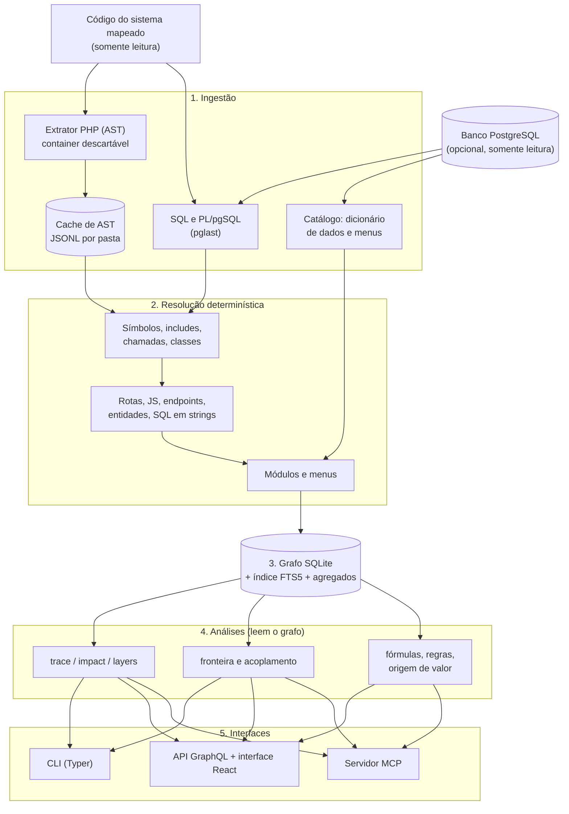

# Arquitetura

Este documento descreve como o `php-map` transforma o código-fonte de um sistema PHP legado em um grafo de conhecimento e como esse grafo é consultado. Para o contrato dos dados, veja [ontologia.md](ontologia.md); para o porquê das escolhas, [decisoes.md](decisoes.md).

## Visão geral

O `php-map` lê um sistema PHP (hoje: e-Cidade e aplicações Zend Framework 1), **sem executar nada dele**, e grava um grafo em um único arquivo SQLite. Todas as interfaces — linha de comando, API GraphQL, interface web e servidor MCP — consultam esse arquivo, sempre somente leitura.



## Princípios

1. **Determinístico primeiro.** Tudo o que a AST, o SQL, o dicionário de dados ou uma convenção explícita permitem afirmar é afirmado sem heurística e sem IA. O que sobra ambíguo vira uma *pendência* registrada, nunca um palpite silencioso.
2. **Toda aresta carrega `source` e `confidence`.** Quem consome o grafo sabe se a ligação veio da AST (1,0), de uma regex validada (0,7), de uma ambiguidade entre *n* candidatos (1/*n*) ou de uma regra de nome (< 1,0). Ver [ontologia.md](ontologia.md).
3. **Reprodutibilidade.** O mesmo código-fonte e o mesmo schema produzem o mesmo grafo. Não há etapa com IA no pipeline de scan.
4. **O grafo é um arquivo.** Um `.db` SQLite autocontido: copia-se, versiona-se por data, serve-se por vários processos ao mesmo tempo.
5. **Somente leitura sobre o sistema mapeado.** O código-fonte nunca é alterado. Do banco, só se lê o dicionário de dados, os menus e o schema (metadados e texto de funções), em transação somente leitura.
6. **Incremental.** O resultado da extração é guardado em cache por arquivo (sha1); um novo scan só reextrai o que mudou.

## Estágios do scan

O comando `php-map scan` (e o botão *Atualizar mapeamento* da interface, que o executa em um subprocesso) percorre os estágios abaixo, na ordem. O resumo gravado ao final (`scan_summary.json`) traz a contagem e o tempo de cada um.

### 1. Ingestão

**Descoberta.** Lista os arquivos PHP do projeto, aplicando as exclusões do perfil (`vendor/`, `node_modules/`, bibliotecas de terceiros etc.; ver [perfis.md](perfis.md)). Arquivos em ISO-8859-1 são convertidos para UTF-8 antes de entrarem no JSON.

**Extração da AST PHP.** O extrator ([`php-extractor/`](../php-extractor/)) é um programa PHP 7.4 baseado em `nikic/php-parser`. Ele roda em um container descartável (`docker run --rm`) e emite **um registro JSON por arquivo**: declarações (funções, classes, métodos), chamadas, `include`/`require`, tipos inferidos de variáveis, strings candidatas a SQL, referências a outros arquivos e a JavaScript, e os textos legíveis por pessoas (comentários, HTML, mensagens). O extrator é tolerante a erro: arquivo que não compila gera um registro `parse_error` e o scan continua.

**Cache de AST.** O resultado da extração fica em `<out>/ast/<pasta>-<hash8>/php.jsonl`, com um `meta.json` que guarda a origem, a versão do formato e o hash do próprio extrator. Com `--reuse-ast`, o scan compara o sha1 de cada arquivo e reextrai só os novos ou alterados; qualquer mudança no extrator invalida o cache inteiro. Há **um cache por pasta de origem**, de modo que alternar entre duas cópias do mesmo sistema não reextrai nada depois da primeira vez.

**SQL e schema.** O schema vem de uma de duas fontes, mutuamente exclusivas: o próprio banco (`--schema-db`, lendo `pg_catalog` em sessão somente leitura: tabelas, colunas, funções, gatilhos e o `search_path`) ou arquivos (`--schema`: um `pg_dump --schema-only` ou scripts incrementais). O `pglast` (o parser do PostgreSQL) transforma DDL e corpo de funções PL/pgSQL em nós `Table` e `PgFunction`. Quando o parser recusa uma função, o carregador recai para uma análise por instrução. Com a leitura do banco, o texto original de cada função também é gravado no grafo.

**Catálogo.** No e-Cidade, o próprio sistema descreve suas tabelas, colunas, módulos e menus em tabelas de configuração. O scan lê essas oito tabelas (ao vivo, com `PHP_MAP_CATALOG_DSN`, ou de arquivos) e produz módulos, itens de menu e os rótulos de negócio de cada coluna. É o que liga uma tela a um item de menu e uma tabela a um módulo.

### 2. Resolução determinística

Com os registros da extração e o schema em mãos, o resolvedor monta os nós e as arestas:

| Passo | O que liga |
|---|---|
| Símbolos | Índice global de funções, classes e métodos; arestas `DECLARES`, `EXTENDS`, `IMPLEMENTS` |
| Includes | `require`/`include` resolvidos pelo perfil (por exemplo, desembrulhando `modification('x.php')`); fechamento transitivo de includes por arquivo |
| Chamadas | `CALLS` e `INSTANTIATES`, desempatando nomes repetidos pelo fechamento de includes e pela convenção de nomes; tipos de receptor por `new`, fábrica de DAO, propriedade, parâmetro tipado e injeção de dependência |
| Referências | Strings que citam outros arquivos (`REFERENCES`), tela → JavaScript e JavaScript → tela |
| SQL em strings | Tabelas lidas e gravadas (`QUERIES`, `INSERTS`, `UPDATES`, `DELETES`) e chamadas a funções do banco (`CALLS_RPC`), primeiro pelo `pglast` e, onde ele não alcança, por regex validada contra o schema |
| Rotas e entidades | Rotas do Laravel → controllers; JavaScript → rota (`CALLS_HTTP`); models Eloquent e entidades Doctrine → tabelas (`MAPS_TO`); rotas e telas do Zend 1 |
| Endpoints | Webservices SOAP declarados em XML, ações de RPC por `switch`, chamadas a serviços externos (`SERVES`, `CALLS_REMOTE`) |
| Módulos | Do catálogo (confiança 1,0) e, para o que ele não classificou, por regra de nome com confiança < 1,0 |

Tudo que não pôde ser resolvido (include dinâmico, chamada ambígua, receptor sem tipo, SQL montado em tempo de execução…) é gravado em `unresolved.jsonl` com o motivo, o trecho e os candidatos. A lista de tipos de pendência está em [ontologia.md](ontologia.md#pendências).

### 3. Grafo, busca e agregados

O grafo é montado em memória (NetworkX, `MultiDiGraph`) e gravado em SQLite. Em seguida, no mesmo arquivo:

- **Índice de busca FTS5**: um documento por arquivo, tabela e ação de menu, com os textos da tela, rótulos do dicionário e nomes de módulo. Há busca por prefixo e por trecho de nome (índice `trigram`). Trechos repetidos em dezenas de arquivos (licença, títulos padrão) são descartados por quase-duplicata.
- **Agregados `analytics_*`**: acoplamento entre módulos (aferente `Ca`, eferente `Ce`, instabilidade `I = Ce / (Ca + Ce)`), tabelas compartilhadas, pontos quentes e telas, calculados num único passe sobre as arestas.
- **Tabelas derivadas das funções do banco**: texto original (`routine_sources`), regras e validações (`routine_rules`), campos e consultas (`routine_fields`), origem de cada função até menu, rota ou arquivo (`analytics_routine*`) e fórmulas por assunto (`routine_formulas`, `routine_rule_topics`).

Essas tabelas são gravadas **depois** do grafo: se uma etapa derivada falhar, o grafo continua válido.

### 4. Análises

Todas leem o `.db` pronto e não alteram nada:

| Análise | O que responde |
|---|---|
| `trace` | Caminho de uma tela até o banco: busca em largura limitada pela profundidade, pelas arestas de fluxo (includes, chamadas, SQL, rotas, JavaScript), com diagrama Mermaid |
| `impact` | O que é atingido por uma mudança numa tabela (busca reversa) |
| `layers` | Camadas de um fonte: menu → tela → JS → rota → controller → service → repository → model/DAO → tabela |
| `boundary` / `cross` | Plano de corte por endpoint, candidatos à extração, matriz de acoplamento entre módulos; cruzamento de dois projetos pelo ID do `Endpoint` |
| Fórmulas e regras | Extração dos cálculos e validações dentro das funções PL/pgSQL, com entradas levadas até `tabela.campo` |
| Origem de valor | "De onde vem este valor?": cadeia de uma coluna até a variável, a instrução, quem grava a tabela e a tela de cadastro |
| Fichas e briefings | Resumo em português, sem IA, de uma função da base ou de uma tela, pronto para colar num assistente |

### 5. Interfaces

- **CLI** (`php-map`, Typer): `scan`, `search`, `trace`, `impact`, `layers`, `boundary`, `cross`, `value-origin`, `index-formulas`, `ui`, `mcp`, `user`, `token`, `setup-extractor`.
- **API GraphQL** (FastAPI + Strawberry, `/graphql`): somente leitura, uma conexão SQLite por requisição. Percursos do `trace` e do `impact` são feitos por SQL, em lotes por nível, o que é ordens de grandeza mais rápido do que carregar o grafo inteiro.
- **Interface web** (React + Vite + TypeScript, TanStack Query), compilada para `ui/dist` e servida pelo `php-map ui`. Só conversa com a API GraphQL.
- **Servidor MCP** (`php-map mcp`, ou `/mcp` dentro do `php-map ui`): ferramentas, recursos e prompts para assistentes de IA. Ver [mcp.md](mcp.md).

## Pacotes

Código em [`src/php_map/`](../src/php_map/):

| Pacote / módulo | Responsabilidade |
|---|---|
| [`cli.py`](../src/php_map/cli.py) | Comandos Typer e barra de progresso do scan (inclusive o modo `--progress-json`, usado pela interface) |
| [`pipeline.py`](../src/php_map/pipeline.py) | Orquestra o scan: validação da pasta, estágios, resumo |
| [`config.py`](../src/php_map/config.py) | Configurações do scan e leitura do `.env` |
| [`profiles/`](../src/php_map/profiles/) | Um perfil por sistema (`ecidade`, `zend1`): marcadores, exclusões, infraestrutura, fábricas de DAO, convenções de classe, origem dos módulos |
| [`ingest/`](../src/php_map/ingest/) | Descoberta, chamada ao extrator PHP, cache de AST, schema (arquivos e banco), catálogo, regras e campos de PL/pgSQL, leitor de JavaScript, XML de webservice |
| [`resolve/`](../src/php_map/resolve/) | Resolução determinística: símbolos, includes, chamadas, referências, SQL em strings, rotas, endpoints, Eloquent, Doctrine, Zend 1, módulos |
| [`graph/`](../src/php_map/graph/) | Modelo (rótulos, tipos de aresta, fontes, validação de contrato), construtor, persistência SQLite, tabelas derivadas das funções |
| [`search/`](../src/php_map/search/) | Índice FTS5 e consulta |
| [`analysis/`](../src/php_map/analysis/) | `trace`, `impact`, camadas, fronteira, cruzamento entre projetos, agregados, fórmulas, origem de valor, acesso a tabelas |
| [`report/`](../src/php_map/report/) | Relatórios Markdown/Mermaid (Jinja2), fichas em português |
| [`briefing/`](../src/php_map/briefing/) | Modelos de briefing (Markdown) e o motor que os preenche com dados do grafo |
| [`web/`](../src/php_map/web/) | API GraphQL, login e permissões, projetos, scan pela interface, montagem do `/mcp` |
| [`access/`](../src/php_map/access/) | Cofre de acesso: usuários, senhas, sessões e tokens do MCP |
| [`mcp/`](../src/php_map/mcp/) | Servidor MCP: ferramentas, prompts, autenticação por token e guia para a IA |
| [`secret_scan.py`](../src/php_map/secret_scan.py) | Varredura de segredos nos grafos antes de qualquer exposição remota |
| [`fsperm.py`](../src/php_map/fsperm.py) | Permissões restritas (arquivo 600, pasta 700) nos arquivos que a ferramenta grava |

Fora do pacote Python: [`php-extractor/`](../php-extractor/) (extrator PHP e o `Dockerfile` da imagem), [`ui/`](../ui/) (interface React), [`scripts/`](../scripts/) (medição de precisão e geração de fixtures) e [`tests/`](../tests/) (testes e fixtures).

## Fluxo de dados e arquivos gerados

Um scan com `--out out/meu-scan` produz:

```
out/meu-scan/
├── graph.db               # o grafo (SQLite) com busca, agregados e tabelas derivadas
├── scan_summary.json      # contagens e tempos de cada estágio, avisos
├── unresolved.jsonl       # pendências: o que não foi resolvido e por quê
├── ast/<pasta>-<hash8>/   # cache de extração, um por pasta de origem
└── grafos/                # grafos gerados pela interface (um por scan)
```

Tudo em `out/` é gerado e pode ser apagado. Quando o grafo é gravado fora da pasta de saída, o resumo e as pendências ficam ao lado dele, com o nome do banco como prefixo.

## Scan pela interface

A mutação `startScan` da API executa `python -m php_map scan … --progress-json` em um subprocesso (um por vez), reaproveitando o mesmo cache de AST, e grava o resultado em `grafos/<data>.db` — um arquivo novo a cada scan, porque substituir um SQLite aberto falha no Windows. O subprocesso escreve uma linha JSON por evento (`start`, `stage`, `done`, `error`) e a interface mostra as etapas e o log em tempo real. Ao terminar, o servidor passa a usar o grafo novo **sem reiniciar**. O DSN do banco nunca trafega pela API: a interface só informa o *nome* da variável do `.env`; o subprocesso herda o ambiente.

## Vários projetos e perfis

A interface e o MCP trabalham com **um projeto por vez**, cada um com seu próprio grafo, listados em um `projects.json` (nome, pasta, perfil, grafo e o nome da variável do `.env` com a conexão do banco). Duas aplicações que se integram — por exemplo, o e-Cidade e um sistema Zend 1 que o chama por SOAP — são mapeadas separadamente e **cruzadas por join**, não fundidas: o `Endpoint` tem o mesmo ID nos dois grafos (o ID nomeia quem *serve*), e `php-map cross` classifica cada endpoint como casado, chamado sem servidor ou servido sem cliente. Ver [perfis.md](perfis.md).

## Servidores e segurança

O `php-map ui` só atende `127.0.0.1`/`localhost` (um `HostGate` recusa outros valores de `Host`), exige login e serve o MCP em `/mcp` com tokens do cofre. Pelo túnel, só `/mcp` responde. Detalhes, modelo de ameaça e operação em [seguranca-operacao.md](seguranca-operacao.md).

## Dependências principais

| Camada | Tecnologia |
|---|---|
| Extrator | PHP 7.4, `nikic/php-parser`, container Docker |
| SQL | `pglast` (parser do PostgreSQL), `psycopg` para ler catálogo e schema |
| Grafo | NetworkX em memória; SQLite (`sqlite3`) e FTS5 em disco |
| CLI e relatórios | Typer, Rich, Jinja2, Pydantic |
| API | FastAPI, Strawberry GraphQL, Uvicorn |
| Interface | React, Vite, TypeScript, TanStack Query, Tailwind, Radix |
| MCP | SDK oficial `mcp` (extra opcional `[mcp]`) |
